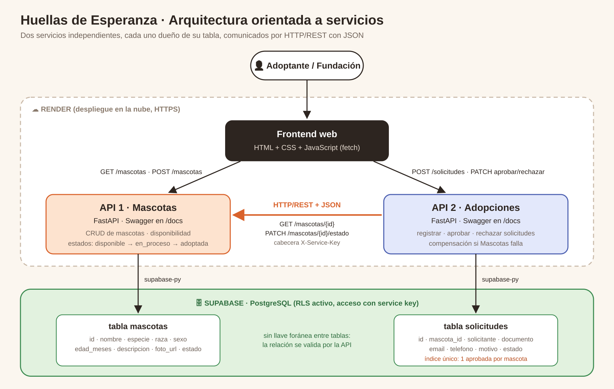
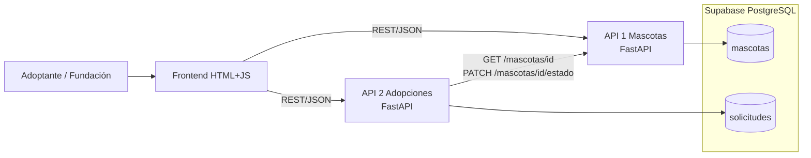
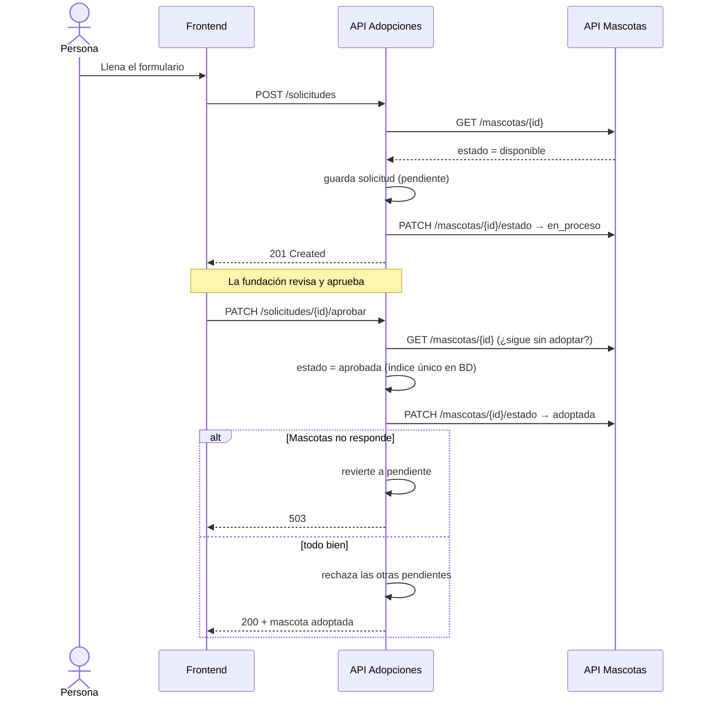
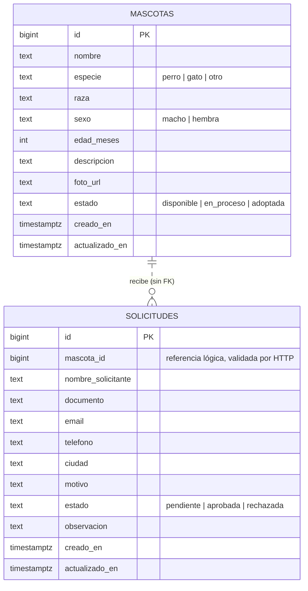

# Huellas de Esperanza · Plataforma de adopción responsable

Examen 2 de Arquitectura Orientada a Servicios (SOA).

La Fundación Huellas de Esperanza tenía la información de sus animales y de las solicitudes de adopción repartida en varios lugares. Nadie sabía con certeza qué mascota seguía disponible, y podía pasar que dos familias recibieran el sí por el mismo perro. Esta plataforma junta todo en un sistema web con dos servicios independientes: uno lleva el inventario de mascotas y el otro el proceso de adopción.

| Componente | URL desplegada |
|---|---|
| Frontend | `https://huellas-frontend.onrender.com` *(reemplazar con la URL real)* |
| API Mascotas (Swagger) | `https://huellas-api-mascotas.onrender.com/docs` |
| API Adopciones (Swagger) | `https://huellas-api-adopciones.onrender.com/docs` |

## Arquitectura





Cada servicio es dueño de su tabla y ningún servicio lee la tabla del otro. Cuando la API de Adopciones necesita saber algo de una mascota, se lo pregunta a la API de Mascotas por HTTP. Por eso `solicitudes.mascota_id` no tiene llave foránea: si mañana la API de Mascotas cambia de base de datos, Adopciones no se entera.

### Responsabilidades

**API 1 · Mascotas** (`api-mascotas/`)
- Registrar, consultar, editar y eliminar mascotas.
- Responder si una mascota está disponible.
- Controlar las transiciones de estado: `disponible → en_proceso → adoptada`. El estado `adoptada` es final.

**API 2 · Adopciones** (`api-adopciones/`)
- Registrar solicitudes después de verificar la mascota en la API 1.
- Aprobar o rechazar solicitudes y pedirle a la API 1 que actualice el estado del animal.
- Rechazar automáticamente las demás solicitudes pendientes cuando una se aprueba.
- Revertir su propio cambio si la API 1 no responde (compensación).

**Frontend** (`frontend/`)
- Catálogo con filtros, formulario de solicitud, panel para aprobar o rechazar, registro de mascotas y una vista de estado que muestra si las dos APIs están en línea y si se ven entre sí.

## Proceso de adopción



| Evento | Solicitud | Mascota |
|---|---|---|
| Primera solicitud de una mascota | `pendiente` | `disponible → en_proceso` |
| Más solicitudes para la misma mascota | `pendiente` | sigue `en_proceso` |
| Se aprueba una | `aprobada`, las otras pasan a `rechazada` | `adoptada` |
| Se rechaza y quedan pendientes | `rechazada` | sigue `en_proceso` |
| Se rechaza la última pendiente | `rechazada` | `en_proceso → disponible` |

## Cómo se evita que una mascota tenga dos adopciones aprobadas

Hay dos barreras. La API revisa el estado de la mascota y las solicitudes aprobadas antes de aprobar. Eso cubre el caso normal, pero si dos administradores hacen clic en "Aprobar" en el mismo segundo, las dos peticiones pasan la revisión a la vez. Para ese caso la base de datos tiene un índice único parcial:

```sql
create unique index una_aprobada_por_mascota
  on solicitudes (mascota_id) where estado = 'aprobada';
```

PostgreSQL deja pasar la primera aprobación y rechaza la segunda con el error `23505`. La API lo traduce a un `409 Conflict`. La prueba `test_09_aprobaciones_simultaneas_solo_una_gana` lanza dos aprobaciones en paralelo y verifica que solo una gana.

## Modelo de datos



El script completo está en [`database/schema.sql`](database/schema.sql). Además del índice de aprobaciones, hay otro que impide que la misma persona (por documento) tenga dos solicitudes pendientes para la misma mascota. Las dos tablas tienen RLS activado y sin políticas, así que la clave pública `anon` no puede leerlas. Solo las APIs, con la clave secreta, tienen acceso.

## Endpoints

### API 1 · Mascotas

| Método | Ruta | Qué hace |
|---|---|---|
| GET | `/` | Salud del servicio |
| GET | `/mascotas?estado=&especie=` | Lista mascotas con filtros |
| GET | `/mascotas/{id}` | Consulta una mascota |
| POST | `/mascotas` | Registra una mascota |
| PUT | `/mascotas/{id}` | Edita datos (no el estado) |
| DELETE | `/mascotas/{id}` | Elimina, solo si está `disponible` |
| GET | `/mascotas/{id}/disponibilidad` | Dice si acepta solicitudes |
| PATCH | `/mascotas/{id}/estado` | Cambia el estado. Requiere `X-Service-Key` |

### API 2 · Adopciones

| Método | Ruta | Qué hace |
|---|---|---|
| GET | `/` | Salud del servicio |
| GET | `/salud` | Salud propia y de la API de Mascotas |
| GET | `/solicitudes?estado=&mascota_id=` | Lista solicitudes |
| GET | `/solicitudes/{id}` | Detalle con los datos de la mascota traídos de la API 1 |
| POST | `/solicitudes` | Registra una solicitud |
| PATCH | `/solicitudes/{id}/aprobar` | Aprueba y marca la mascota como adoptada |
| PATCH | `/solicitudes/{id}/rechazar` | Rechaza y, si era la última, libera la mascota |

Códigos de respuesta usados: `201` creado, `404` no existe, `409` regla de negocio violada, `401` falta la clave de servicio, `422` datos inválidos, `503` el otro servicio no responde.

## Decisiones técnicas

1. **Base de datos compartida, tablas separadas por dueño.** Un solo proyecto de Supabase alcanza para el plan gratuito. La independencia se mantiene porque cada API solo toca su tabla.
2. **Sin llave foránea entre tablas.** La relación mascota-solicitud se valida por HTTP. Así los servicios se pueden desplegar, cambiar o escalar por separado.
3. **Índice único parcial** para la regla de una adopción aprobada por mascota. La validación en código sola no aguanta peticiones simultáneas.
4. **Compensación en lugar de transacción distribuida.** Si Adopciones aprueba y la API de Mascotas falla al marcar el animal como adoptado, Adopciones devuelve la solicitud a `pendiente` y responde `503`. Es el patrón Saga en su versión más sencilla.
5. **Clave entre servicios (`X-Service-Key`).** Cualquiera puede consultar mascotas, pero solo la API de Adopciones puede cambiar su estado. El frontend nunca llama a ese endpoint.
6. **Estado `adoptada` final.** La API de Mascotas rechaza cualquier intento de devolver una mascota adoptada a `disponible`.
7. **Repositorio en memoria para pruebas.** Con `DB_MODE=memory` las APIs corren sin Supabase. Las pruebas de integración se ejecutan igual contra la versión local o la desplegada.
8. **Frontend sin framework.** HTML, CSS y JavaScript con `fetch`. Se despliega como sitio estático y no necesita proceso de build.

## Correr en local

Requisitos: Python 3.11 o superior.

```bash
# 1. API de Mascotas (terminal 1)
cd api-mascotas
python -m venv .venv
source .venv/bin/activate          # Windows: .venv\Scripts\activate
pip install -r requirements.txt
cp .env.example .env               # y llenar SUPABASE_URL, SUPABASE_KEY, SERVICE_API_KEY
uvicorn main:app --reload --port 8001

# 2. API de Adopciones (terminal 2)
cd api-adopciones
python -m venv .venv
source .venv/bin/activate
pip install -r requirements.txt
cp .env.example .env               # misma SERVICE_API_KEY, MASCOTAS_API_URL=http://localhost:8001
uvicorn main:app --reload --port 8002

# 3. Frontend (terminal 3)
cd frontend
python -m http.server 8080         # abrir http://localhost:8080
```

Para probar sin Supabase, pon `DB_MODE=memory` en los dos `.env`.

## Despliegue

1. **Supabase:** crear el proyecto, ejecutar `database/schema.sql` en el SQL Editor y copiar la URL y la clave secreta (`service_role` o `sb_secret_…`) desde *Project Settings → API Keys*.
2. **GitHub:** subir este repositorio. El `.gitignore` deja los `.env` por fuera.
3. **Render:** *New → Blueprint* y escoger el repositorio. Render lee `render.yaml` y crea los tres servicios. Pide los valores marcados como `sync: false`:
   - `SUPABASE_URL` y `SUPABASE_KEY` en las dos APIs.
   - `MASCOTAS_API_URL` en Adopciones, con la URL pública de la API de Mascotas.
   - `MASCOTAS_API` y `ADOPCIONES_API` en el frontend.

   La `SERVICE_API_KEY` se genera sola en Mascotas y Render la copia a Adopciones.

El plan gratuito de Render apaga los servicios tras 15 minutos sin tráfico y tarda cerca de un minuto en despertarlos. Antes de una demo, abre los dos `/docs` para que arranquen. El frontend muestra un aviso si la respuesta se demora.

## Pruebas de integración

Las pruebas hablan con las APIs por HTTP, igual que el frontend. Crean sus propios datos, así que se pueden correr varias veces.

```bash
pip install pytest httpx
# contra local
SERVICE_API_KEY=tu-clave pytest -v tests/
# contra la nube
MASCOTAS_URL=https://huellas-api-mascotas.onrender.com \
ADOPCIONES_URL=https://huellas-api-adopciones.onrender.com \
SERVICE_API_KEY=tu-clave pytest -v tests/
```

`tests/demo_flujo.py` recorre el proceso completo paso a paso e imprime cada petición y respuesta. Sirve para la demostración en vivo. Las salidas guardadas y las capturas están en [`docs/evidencias/`](docs/evidencias/) y el detalle de cada caso en [`docs/pruebas-integracion.md`](docs/pruebas-integracion.md).

## Estructura

```
├── api-mascotas/         API 1 (FastAPI)
│   ├── main.py           endpoints y reglas de estado
│   └── db.py             acceso a Supabase / memoria
├── api-adopciones/       API 2 (FastAPI)
│   ├── main.py           endpoints y proceso de adopción
│   ├── cliente_mascotas.py   cliente HTTP hacia la API 1
│   └── db.py
├── frontend/             sitio estático
├── database/schema.sql   tablas, índices, RLS y datos iniciales
├── tests/                pruebas de integración y demo
├── docs/                 diagrama, evidencias
└── render.yaml           despliegue de los tres servicios
```

## Autores

- Adrian Camilo Trigos Quitnero - 0192204
- Andres Felipe Sepulveda Gaona - 0192228

Universidad Francisco de Paula Santander Ocaña · Arquitectura Orientada a Servicios · 2026
